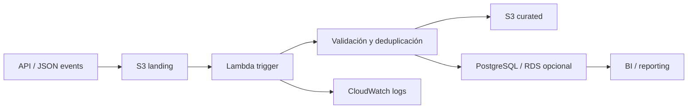

# AWS Event Integration Pipeline

Proyecto demostrativo de ingeniería de datos que procesa eventos JSON con validación, deduplicación e idempotencia, inspirado en una arquitectura serverless de AWS.

## Arquitectura objetivo



## Ejecución local

Requiere Python 3.10+. No necesita paquetes externos ni cuenta AWS.

```bash
python src/process_events.py
```

El pipeline lee eventos JSON, conserva una copia raw, valida estructura y campos, separa registros aceptados y rechazados y genera un resumen JSON.

## Diseño técnico

- **Landing:** conservación del evento original para trazabilidad.
- **Validación:** estructura, identificador, timestamp y reglas de negocio.
- **Curated:** eventos válidos y únicos.
- **Idempotencia:** la salida se reconstruye desde el origen; el SQL PostgreSQL utiliza `ON CONFLICT DO NOTHING`.
- **Operación objetivo:** S3, Lambda, IAM de mínimo privilegio, CloudWatch y RDS PostgreSQL opcional.

## Estructura

- `src/process_events.py`: procesamiento local.
- `data/incoming/`: datos sintéticos de entrada.
- `data/landing/`: copia raw.
- `data/curated/`: eventos válidos.
- `data/rejected/`: eventos rechazados.
- `sql/postgresql/`: esquema y carga idempotente.
- `reports/`: métricas de ejecución.
- `docs/interview_notes.md`: decisiones técnicas para entrevista.

## Alcance y transparencia

El procesamiento Python se ejecuta localmente. S3, Lambda, CloudWatch y RDS describen la arquitectura objetivo; no se afirma un despliegue productivo en AWS. Todos los datos del repositorio son sintéticos.

## Próximas mejoras

- Pruebas automatizadas con pytest.
- Handler Lambda y plantilla de infraestructura como código.
- CI con GitHub Actions.
- Métricas y alertas operacionales.
