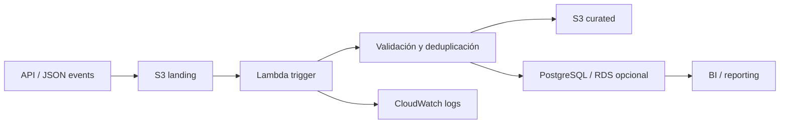

# Proyecto 2 — Integración de eventos empresariales (AWS)

## Resumen ejecutivo
Solución de ingesta de eventos desde una API, almacenamiento raw, validación, deduplicación y publicación en PostgreSQL. Simula localmente un patrón serverless basado en S3 + Lambda, con SQL para persistencia analítica.

**Stack:** Python 3.10+, SQL, PostgreSQL (opcional), AWS S3/Lambda (arquitectura objetivo).  
**Ejecución sin costo:** el flujo principal utiliza Python estándar y archivos locales. No requiere AWS ni PostgreSQL para demostrar el procesamiento.

## Caso de negocio
Una compañía recibe eventos de pedidos, pagos y despachos desde una API de comercio. Requiere trazabilidad, procesamiento idempotente y una capa curada para reportería operacional.

## Arquitectura


## Ejecutar localmente
Desde esta carpeta:
```bash
python src/process_events.py
```
Produce:
- `data/landing/`: copia raw de entrada.
- `data/curated/events_curated.csv`: eventos válidos y únicos.
- `data/rejected/events_rejected.csv`: eventos rechazados.
- `reports/run_summary.json`: métricas de ejecución.

Sin dependencias externas. Python 3.10+.

## Diseño de idempotencia
`event_id` es la clave natural. La salida se reconstruye desde el archivo raw, por lo que volver a ejecutar no duplica registros. En producción, usar `INSERT ... ON CONFLICT DO NOTHING` o `MERGE`, junto con un control de lote/checkpoint.

## AWS opcional
- S3: `incoming/`, `processed/`, `rejected/`.
- Lambda: disparador S3 para validar y transformar.
- IAM: rol de mínimo privilegio.
- CloudWatch: logs, métricas y alarmas.
- RDS PostgreSQL: persistencia relacional opcional.

El código local representa la lógica de negocio. La adaptación a Lambda requiere empaquetar el handler, configurar permisos, variables de entorno y límites de ejecución. No desplegar recursos para una entrevista; mostrar el diagrama y el flujo local es suficiente.

## Seguridad y operación
- No almacenar secretos en código.
- Aplicar IAM least privilege.
- Cifrar almacenamiento y conexiones.
- Definir retención y política de lifecycle.
- Reintentos con backoff y cola DLQ para fallos persistentes.
- Alertas por fallos, retrasos y aumento de rechazos.
