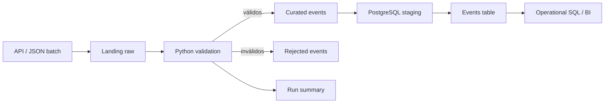

# Arquitectura y flujo de eventos — AWS

## Componentes lógicos
- **Landing:** conserva el JSON original recibido.
- **Validación:** verifica estructura, campos, timestamp, importe y clave de idempotencia.
- **Curated / rejected:** separa eventos aceptados y rechazados, manteniendo trazabilidad.
- **Persistencia SQL:** staging recibe el lote; la tabla final impone PK sobre `event_id`.
- **Operación:** resumen JSON y consultas agregadas permiten observar volúmenes y tendencias.

## Evolución cloud propuesta
API Gateway, S3, Lambda, SQS DLQ, IAM y CloudWatch son componentes objetivo documentados, no recursos desplegados. El repositorio ejecuta el procesamiento localmente y no requiere cuenta AWS.
